  

 

  

I'm an **Informatics student** at Universitas Teknologi Digital Indonesia and a **Full-Stack Developer** who enjoys turning thoughtful design into reliable, user-friendly web applications.

- 💻 Focused on **Full-Stack Web Development**
- 🔧 Building web applications with **PHP, Laravel & MySQL**
- 🎨 Passionate about **UI/UX Design** and interface prototyping
- 🤝 Bridging the gap between design and engineering
- 💬 Always open to discussing tech trends and collaboration
- 🌱 Always learning and improving my development skills

 

 

  

| | |
| :-- | :-- |
| **💻 Frontend** |  |
| **⚙️ Backend** |  |
| **🗄️ Database** |  |
| **🔧 Tools** |  |
| **🎨 Design** |   |

 

  

  
  

 

  

I'm continuously improving my knowledge in:

- 🔥 **Laravel & REST API**
- 🗄️ **Database Design & Optimization**
- ⚛️ **Modern JavaScript & Frontend**
- 🎨 **UI/UX Design & Design Systems**
- 🏗️ **Clean Code & Software Architecture**

 

 

  

> **"Design with empathy, build with precision, and ship products people enjoy using."**

I believe good software should be:

**Clean • Maintainable • User-Centric • Secure • Useful**

 

  

  
  &nbsp;
  
  &nbsp;
  

  <a href="https://github.com/nyndaa">GitHub</a>
  •
  <a href="https://linkedin.com/in/LINK_LINKEDIN_KAMU">LinkedIn</a>
  •
  <a href="mailto:EMAIL_KAMU@gmail.com">Email</a>

 

  <b>Thanks for visiting my profile! 🚀</b>

  

  

