  

  

  

As a Full-Stack Web Developer, I specialize in architecting and deploying robust web applications utilizing PHP, Laravel, and MySQL. My primary focus is on delivering scalable software solutions that meet strict technical requirements while prioritizing the end-user experience. By integrating solid backend engineering principles with a deep understanding of UI/UX design and interface prototyping, I effectively bridge the gap between complex system architecture and intuitive user interfaces. I am highly driven by a commitment to writing clean, maintainable code and continuously refining my technical stack. Always eager to tackle new challenges, I actively welcome opportunities for cross-functional collaboration and strategic discussions surrounding modern web development standards.

 

  

  

  

 

  

  

  

  
  

  

  

  

  

  
  &nbsp;&nbsp;
  
  &nbsp;&nbsp;
  

 

  <b>Thanks for visiting my profile!!!</b>

